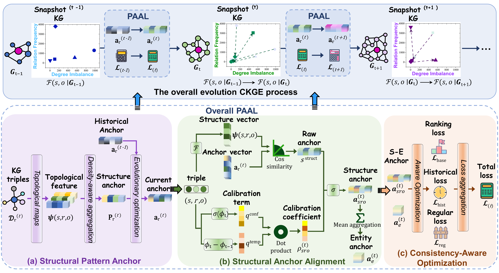

<div align="center">

# ⚓ PAAL

### Pattern-Anchor Alignment for Continual Knowledge Graph Embedding Under Structural Distribution Shift

Yue Jian<sup>1</sup>, Lin Li<sup>1,\*</sup>, Kaize Shi<sup>2</sup>, Junwei Zhou<sup>1</sup>, Yu Yang<sup>3</sup>

<sup>1</sup>Wuhan University of Technology &nbsp;&nbsp;<sup>2</sup>University of Southern Queensland &nbsp;&nbsp;<sup>3</sup>The Education University of Hong Kong<br>
<sup>\*</sup>Corresponding author

<p>
  <a href="https://www.ijcai.org/proceedings/2026/433"></a>
  <a href="https://www.ijcai.org/proceedings/2026/0433.pdf"></a>
  <a href="https://doi.org/10.24963/ijcai.2026/433"></a>
</p>

*Proceedings of the Thirty-Fifth International Joint Conference on Artificial Intelligence (IJCAI-26), Main Track, pp. 3890–3898*

</div>

---

## 🧩 Framework

Real-world knowledge graphs do not just grow as new facts arrive; their topology changes too, so the structure of newly added triples can drift away from that of historical data. **PAAL** handles this *structural distribution shift* with relation-level structural anchors: it checks how well each incoming triple agrees with its relation's anchor and uses this calibrated signal to decide how strongly previously learned knowledge should be preserved. PAAL raises average H@1 by **11.77%** on pattern-shift CKGE benchmarks and by **9.29%** on standard ones.

<p align="center">
  
</p>

- **(a) Structural Pattern Anchor**: extracts a topological feature vector for every triple, aggregates these features per relation with density-aware weighting, and evolves each relation anchor from the previous snapshot with momentum.
- **(b) Structural Anchor Alignment**: scores each triple by the cosine similarity between its structure vector and its relation anchor, then gates the score with a calibration coefficient built from model confidence and temporal stability; triple-level scores are averaged into entity-level ones.
- **(c) Consistency-Aware Optimization**: uses these alignment scores to weight the historical-consistency and regularization losses, which are added to the margin ranking loss.

## 📝 Citation

If you find PAAL useful in your research, please cite our paper:

```bibtex
@inproceedings{ijcai2026p433,
  title     = {PAAL: Pattern-Anchor Alignment for Continual Knowledge Graph Embedding Under Structural Distribution Shift},
  author    = {Jian, Yue and Li, Lin and Shi, Kaize and Zhou, Junwei and Yang, Yu},
  booktitle = {Proceedings of the Thirty-Fifth International Joint Conference on Artificial Intelligence, {IJCAI-26}},
  publisher = {International Joint Conferences on Artificial Intelligence Organization},
  editor    = {Diego Calvanese},
  pages     = {3890--3898},
  year      = {2026},
  month     = {8},
  note      = {Main Track},
  doi       = {10.24963/ijcai.2026/433},
  url       = {https://doi.org/10.24963/ijcai.2026/433},
}
```

## 🛠️ Requirements

The code runs with **Python 3.10**, **PyTorch 1.13.1** and **CUDA 11.7**. Key dependencies (listed in [`requirements.txt`](requirements.txt)):

| Category | Packages |
|:---------|:---------|
| Deep learning | `torch==1.13.1+cu117`, `torch-scatter` |
| Graph & numerical computing | `numpy==1.24.2`, `pandas==2.2.3`, `networkx==3.3`, `quadprog==0.1.13` |
| Training utilities | `tqdm==4.66.5`, `prettytable==3.11.0`, `termcolor==2.4.0`, `dill==0.3.9` |
| Visualization | `matplotlib==3.9.2`, `seaborn==0.13.2`, `pillow==10.4.0` |
| Supporting libraries | `typing_extensions==4.12.2`, `python-dateutil==2.9.0.post0`, `pytz==2024.2`, `tzdata==2024.2`, `contourpy==1.2.1`, `cycler==0.12.1`, `fonttools==4.53.1`, `kiwisolver==1.4.5`, `pyparsing==3.1.2`, `wcwidth==0.2.13` |


## 🚀 Quick Start

After setting up the environment, run:

```bash
python main.py
```
